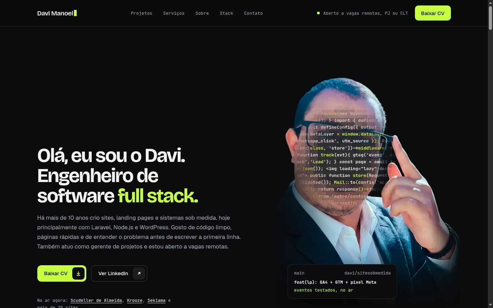
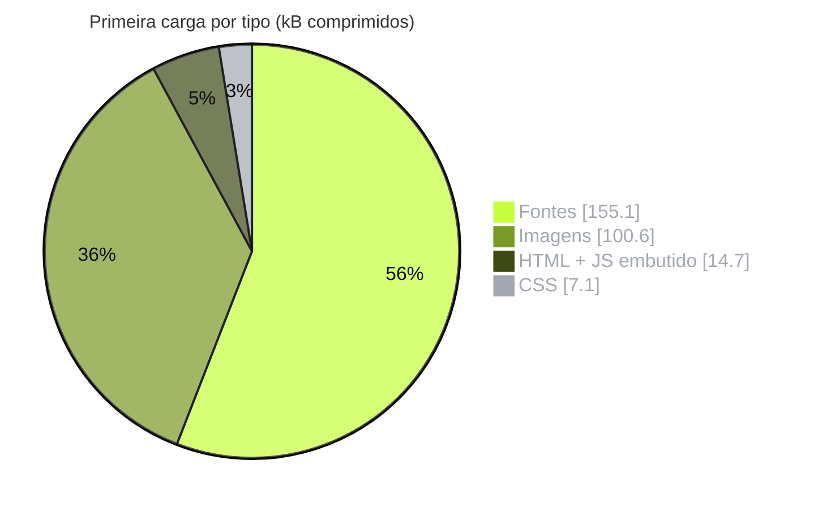
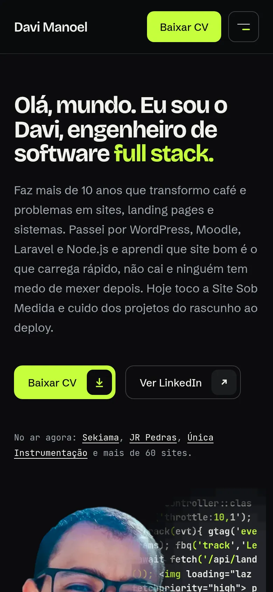
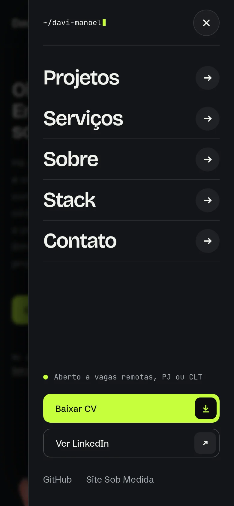
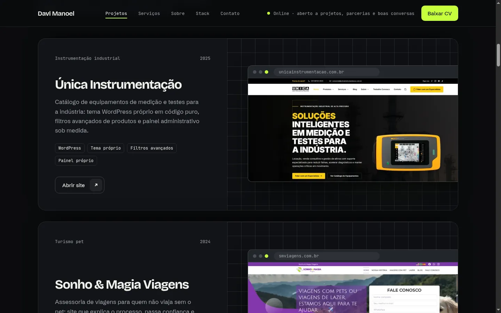
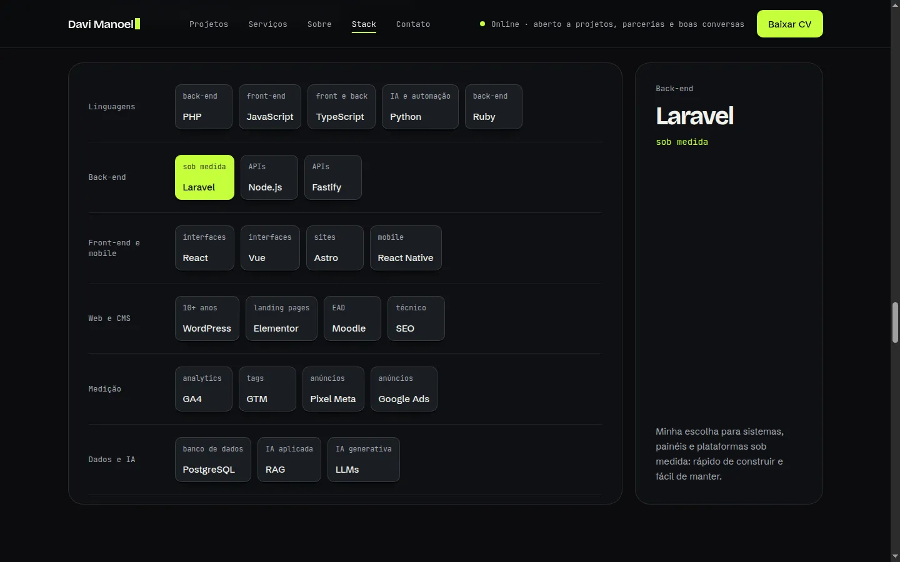
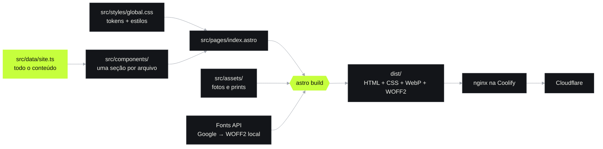

<div align="center">



# Davi Manoel · site pessoal

**Engenheiro de software full stack.** Portfólio em página única: estático, leve, acessível e
feito para carregar rápido até no 4G.

[](https://astro.build)
[](tsconfig.json)
[](#em-números)
[](#em-números)
[](.nvmrc)

**[davimanoel.com.br](https://www.davimanoel.com.br/)** · [LinkedIn](https://www.linkedin.com/in/davi-manoel/) · [Site Sob Medida](https://www.sitesobmedida.com.br/) · [GitHub](https://github.com/sondavi1991)

</div>

---

## Em números

Medido no build de produção, primeira visita em desktop, sem cache:

| Métrica | Valor |
| --- | --- |
| Requisições | **9** |
| Peso transferido | **~278 kB** (comprimido) |
| JavaScript | **2,9 kB**, embutido no HTML, sem framework |
| Fontes | 3 arquivos variáveis WOFF2, servidos pelo próprio site |
| Imagens | WebP responsivo; a foto do hero carrega de imediato e os prints dos projetos, sob demanda |



## Telas

<p align="center">
  
  &nbsp;&nbsp;
  
</p>

<p align="center">
  
</p>

<p align="center">
  
</p>

## Destaques

- **Código sob o cursor.** No hero, a foto revela trechos reais de código por onde o mouse passa:
  uma máscara em CSS, posicionada por um script de poucas linhas.
- **Abertura do hero.** As palavras do título sobem por trás de uma máscara, o código varre a foto
  uma vez e o commit é digitado caractere por caractere. No celular, a sequência dispara quando a
  foto entra na tela.
- **Animações guiadas pelo scroll, em CSS puro.** A pilha de projetos ganha profundidade (o card de
  trás afunda quando o próximo chega), a seção de números abre em círculo e conta junto com os
  anéis, o texto do Sobre acende palavra por palavra, a carreira é digitada como um `git log` e o
  nome do rodapé sobe letra a letra. Tudo com `animation-timeline` e versão estática onde o
  navegador não suporta.
- **Projetos em janela de navegador.** Cada print entra numa janela desenhada em CSS, com a
  barra de endereço mostrando o domínio do cliente. Projeto que ainda não está no ar aparece sem o
  botão de abrir e com “em breve no ar” na barra.
- **Menu lateral no celular** com `<dialog>` nativo: prende o foco, fecha com Esc ou tocando fora
  e devolve o foco ao botão. O menu destaca a seção que está na tela.
- **Teclado de stack interativo.** Funciona com mouse, toque e Tab. No celular, o painel de
  descrição acompanha a rolagem.
- **Fontes sem depender do Google.** Bricolage Grotesque, Schibsted Grotesk e JetBrains Mono são baixadas no
  build (com o eixo de tamanho óptico da Bricolage) e servidas pelo próprio site, com `preload` e
  fonte reserva calibrada para a página não “pular” enquanto carrega.
- **404 com cara de terminal.** Um link quebrado mostra o `git checkout` que falhou, com o
  endereço que a pessoa tentou abrir, e botões de volta para o início.
- **Conteúdo separado do layout.** Textos, projetos, stack, carreira e FAQ moram num único arquivo
  de dados.

## Como funciona



## Busca e compartilhamento

- **Metatags completas:** título e descrição dentro do limite do Google, canonical, Open Graph e
  cartão do X com imagem 1200×630, favicons para navegador, busca e tela inicial do iPhone.
- **Dados estruturados** em JSON-LD (`WebSite`, `ProfilePage` e `Person`), montados a partir do
  mesmo arquivo de conteúdo: serviços, projetos, stack e perfis entram sozinhos.
- **Arquivos para robôs gerados no build:** `sitemap.xml`, `robots.txt` e `llms.txt`, um resumo
  da página em Markdown para leitores automáticos.
- **Um endereço por página:** o domínio sem `www`, o `http` e o `/index.html` redirecionam com 301
  para `https://www.davimanoel.com.br/`. Endereço que não existe responde 404 de verdade, com
  `noindex`.

## Acessibilidade

- Contraste mínimo de 4,5:1 no texto (3:1 em títulos grandes), conferido em 320, 390 e 1440 px.
- Alvos de toque com pelo menos 44 px; sem rolagem horizontal até 320 px, nem com texto a 200%.
- Link “Pular para o conteúdo”, foco visível em tudo, hierarquia de títulos limpa e landmarks.
- A faixa de sites em movimento tem botão de pausa (WCAG 2.2.2) e para sozinha com o mouse ou o
  foco em cima.
- Com “reduzir movimento” ligado, nada se desloca: o retorno visual continua por cor e opacidade.

## Stack

| Camada | Ferramenta |
| --- | --- |
| Framework | [Astro 7](https://astro.build), saída estática |
| Linguagem | TypeScript em modo `strict` |
| Estilos | CSS puro com custom properties |
| Fontes | Fonts API do Astro: Bricolage Grotesque, Schibsted Grotesk e JetBrains Mono |
| Imagens | `astro:assets` + Sharp (WebP em vários tamanhos) |
| Interações | `<script>` nativos, sem framework de UI |

## Rodando localmente

Requer **Node.js 22.23.4 ou mais recente** (há um `.nvmrc` na raiz).

```bash
npm install
npm run dev        # http://localhost:4321
```

| Comando | O que faz |
| --- | --- |
| `npm run dev` | Servidor de desenvolvimento |
| `npm run build` | Gera o site estático em `dist/` |
| `npm run preview` | Serve o build de produção localmente |
| `npm run check` | Checa tipos e diagnósticos dos `.astro` |

## Estrutura

```text
├── .github/assets/           # imagens deste README
├── public/
│   ├── favicon.svg           # favicon dos navegadores atuais
│   ├── favicon.ico           # navegadores antigos
│   ├── favicon-96x96.png     # ícone nos resultados de busca
│   ├── apple-touch-icon.png  # ícone na tela inicial do iPhone
│   ├── og.jpg                # imagem de compartilhamento (1200×630)
│   └── images/hero-mask.png  # máscara do efeito de código no hero
├── src/
│   ├── assets/               # fotos e prints, otimizados no build
│   ├── components/           # uma seção da página por componente
│   ├── data/site.ts          # todo o conteúdo do site
│   ├── layouts/Layout.astro  # <head>, metatags e fontes
│   ├── pages/index.astro     # monta as seções
│   ├── pages/404.astro       # página de “commit não encontrado”
│   ├── pages/robots.txt.ts   # robots.txt gerado no build
│   ├── pages/sitemap.xml.ts  # sitemap gerado no build
│   ├── pages/llms.txt.ts     # resumo do site em Markdown, gerado do site.ts
│   └── styles/global.css     # tokens e estilos, por seção
├── astro.config.mjs          # domínio e fontes
├── Dockerfile                # imagem de produção (build + nginx)
└── nginx.conf                # cache, compressão, 404 e cabeçalhos de segurança
```

## Editando o conteúdo

Quase tudo que aparece na página está em [`src/data/site.ts`](src/data/site.ts):

- `SITE`: nome, status, links, o endereço do currículo (`cvUrl`) e os textos de busca (`title` e
  `description`), que também alimentam as metatags de compartilhamento e os dados estruturados.
- `PROJECTS`: os cards de projetos. Para trocar um print, coloque a imagem em
  `src/assets/projetos/`, importe no topo do arquivo e atualize o `imageAlt` (o texto que
  descreve o print para leitores de tela e para o Google). Sem `url`, o card fica sem o botão
  “Abrir site” (projeto que ainda não está no ar).
- `LIVE_SITES`, `STACK`, `SERVICES`, `CAREER`, `HOUSE_RULES` e `FAQ`: as demais seções.

Os dados estruturados e o `llms.txt` saem desse mesmo arquivo: mudou o conteúdo, eles acompanham
no próximo build.

Cores e espaçamentos ficam nas custom properties do bloco `.dm` em
[`src/styles/global.css`](src/styles/global.css). Para trocar uma fonte, mude o `name` dela em
[`astro.config.mjs`](astro.config.mjs): o CSS usa só as variáveis `--font-display`,
`--font-body` e `--font-mono`.

## Deploy

O site roda na [Coolify](https://coolify.io) a partir do [`Dockerfile`](Dockerfile): o Node gera o
`dist/` e uma imagem `nginx` serve os arquivos, com a configuração em [`nginx.conf`](nginx.conf).

Para criar a aplicação na Coolify:

1. **New Resource → Public/Private Repository** apontando para este repositório, branch `main`.
2. **Build Pack:** `Dockerfile`. **Ports Exposes:** `80`.
3. **Domains:** `https://davimanoel.com.br,https://www.davimanoel.com.br`. O endereço principal é
   o `www`: o [`nginx.conf`](nginx.conf) redireciona o domínio sem `www` com um 301, então o
   **Direction** pode ficar em *Allow www & non-www*. O HTTPS (Let's Encrypt) fica com o proxy
   da Coolify.
4. Ative o deploy automático a cada push na `main`.

Na frente da Coolify fica o Cloudflare. Ele acrescenta regras próprias no começo do `robots.txt`
e pode barrar robôs de IA pelo user agent; a política de robôs que vale em produção é a que
estiver configurada lá.

O `site` em [`astro.config.mjs`](astro.config.mjs) precisa ser o domínio final: ele entra no
canonical, no `sitemap.xml`, no `robots.txt` e nas metatags. Se o domínio mudar, refaça também o
`public/og.jpg`, que tem o endereço escrito na imagem.

Para testar a imagem de produção na sua máquina:

```bash
docker build -t davimanoel-site .
docker run --rm -p 8080:80 davimanoel-site   # http://localhost:8080
```

## Direitos

O código está aberto para consulta e estudo. Textos, fotos e marcas são pessoais ou de clientes e
não podem ser reutilizados sem autorização.

<div align="center">
<br>
<sub>Feito em Ribeirão Preto, SP, por <a href="https://www.linkedin.com/in/davi-manoel/">Davi Manoel</a>.</sub>
</div>
